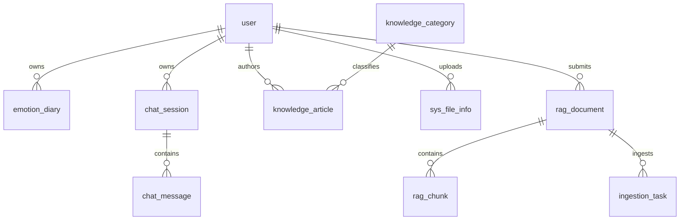

# 第10至14周技术要求实现与验收

本文仅说明本次新增的AI知识资料、异步入库、缓存、接口文档和MCP模块。既有模块见README。个人报告应由本人填写姓名、负责范围和真实验收截图；本文不虚构组员分工或实际运行结果。

## 要求对应

| 要求 | 实现 | 验收入口 |
| --- | --- | --- |
| Redis | 知识分类缓存5分钟，故障回源数据库，管理员可清理缓存 | 分类接口、后台AI知识资料 |
| RabbitMQ | 持久化队列、发布确认、消费重试、死信、数据库任务状态 | 后台提交资料并查看QUEUED到READY |
| Swagger | Bearer JWT授权文档 | `/swagger-ui.html`、`/v3/api-docs` |
| RAG | 文档分块、相关片段检索、注入Spring AI上下文、保存实际资料引用 | 后台AI知识资料、前台知识库资料检索、AI对话 |
| MCP | 2025-03-26无状态Streamable HTTP服务 | `/api/mcp`、`scripts/mcp-smoke.ps1` |
| 至少8张非RBAC表 | 共10张表，排除user后9张业务表 | MySQL `SHOW TABLES` |

RAG采用中文二元词项与英文单词重叠评分，选取4个相关片段；不是向量检索，不依赖额外Embedding接口。候选上限为最近资料的5000个分块，适用于课程演示规模。没有相关资料时继续一般对话，不附带虚构的检索引用。资料URL仅保存，不抓取网页；目前导入格式是纯文本。

## 数据关系



新增 `rag_chunk.document_id`、`ingestion_task.document_id` 对文档表有数据库外键。其他表使用已有ID逻辑关联。文档与任务同事务保存，资料不可原地修改；需更新时停用原资料再导入新版本，避免历史引用指向被改写的内容。

## 本地启动

需要Docker Compose、Java17、Maven3、Node.js及已有README说明的大模型密钥和JWT配置。本次自动化环境未安装Docker/MySQL命令，下列部署命令需在具备环境的机器执行，不代表已经部署。

在根目录执行：

```powershell
docker compose up -d --wait
$env:SPRING_DATASOURCE_URL='jdbc:mysql://localhost:3306/mental_health_assistant?useSSL=false&serverTimezone=Asia/Shanghai&allowPublicKeyRetrieval=true'
$env:SPRING_DATASOURCE_USERNAME='root'
$env:SPRING_DATASOURCE_PASSWORD='local-root-change-me'
$env:REDIS_CACHE_ENABLED='true'
$env:RAG_INGESTION_ENABLED='true'
$env:RABBITMQ_USER='mental'
$env:RABBITMQ_PASSWORD='local-development-only'
# 继续按README设置真实大模型密钥及JWT密钥。
Set-Location backend
.\mvnw.cmd spring-boot:run
```

另开终端按README启动前端。Compose仅绑定本机端口，默认密码仅用于本地演示。已有MySQL时只启动 `docker compose up -d redis rabbitmq`；3306被占用可设置MYSQL_PORT并相应调整数据源端口。生产环境使用独立密码、TLS和网络访问控制。

已有库先备份，再执行 `backend/sql/schema.sql` 新增三张表，原数据不删除。已有Docker数据卷不会重新执行初始化脚本，必须手动升级；不要为了升级删除数据卷。

默认不启用Redis缓存及RabbitMQ消费者，避免无中间件时影响已有功能。管理页面会提示入库未启用，此时资料停留QUEUED不可检索；完整验收必须开启上述两个开关。“已配置启用”只是配置状态，不表示连接健康检查通过。Redis故障时分类接口回源数据库，清理缓存失败会返回错误。

## 异步入库流程

1. 管理员提交标题、HTTP(S)来源URL和最多100000字的纯文本，保存文档与PENDING任务。
   首次演示可复制 `docs/sample-knowledge.txt`，标题填写“心理健康助手使用说明”，来源URL留空；入库后提问“怎样查看近7天情绪趋势”，核对资料引用。示例是产品使用说明，不是医学知识库。
2. 调度器每5秒发布最多10个任务，消息只带任务ID。持久化交换机 `mental.rag`、队列 `mental.rag.ingestion` 使用发布确认。
3. 确认后记录PUBLISHED；最多3次发布失败转FAILED，管理端可手动重试。SENDING超过1分钟会恢复，避免发布中途退出丢工作。
4. 消费者通过事务和文档行锁分块、写片段并标记READY/DONE，重复消息不重复增加分块。失败回滚并记录FAILED。
5. 消费最多重试3次，最终进入 `mental.rag.ingestion.dead`。排查后通过管理页重试；停用资料遇到迟到消息不会恢复启用。
6. 停用立即影响后续检索，已有聊天引用仍保留。公共资料中不要导入个人隐私日志。

## MCP与接口

协议依据：[MCP传输规范](https://modelcontextprotocol.io/specification/2025-03-26/basic/transports)、[MCP工具规范](https://modelcontextprotocol.io/specification/2025-03-26/server/tools)。当前是JSON响应的无状态Streamable HTTP，GET返回405，不提供服务端主动SSE。每次请求使用现有JWT，不是OAuth授权服务器。

工具 `search_knowledge(query)` 检索READY资料；`get_my_emotion_trend(days)` 只读取当前用户7天或30天趋势，不接受userId，无删除或写入工具。每用户每进程60请求/分钟；带Origin的请求须匹配白名单，可通过 `app.mcp.allowed-origins` 配置部署域名。无Origin的非浏览器客户端仍需有效JWT。

```powershell
$env:MHA_TOKEN='<普通用户登录后的JWT>'
.\scripts\mcp-smoke.ps1
Remove-Item Env:MHA_TOKEN
```

| 方法和路径 | 权限 | 用途 |
| --- | --- | --- |
| GET `/api/rag/search?query=睡眠` | 已登录 | 返回标题、文档ID、片段、正文和来源 |
| GET/POST `/api/rag/admin/documents` | 管理员 | 分页查看、提交资料 |
| POST `/api/rag/admin/documents/{id}/retry` | 管理员 | 重试失败任务 |
| DELETE `/api/rag/admin/documents/{id}` | 管理员 | 软停用资料 |
| GET `/api/rag/admin/status` | 管理员 | 配置开关状态 |
| POST `/api/rag/admin/cache/evict` | 管理员 | 清理分类缓存 |
| POST `/api/mcp` | 已登录 | JSON-RPC协议请求 |

Swagger页面可公开查看接口结构，实际调用仍校验JWT及管理员权限。在Authorize中填入JWT可测试业务接口。

## 测试与验收记录

自动测试使用H2真实事务验证文档、分块和任务的一致性、幂等、检索、停用和重试。RabbitMQ发布确认、Redis命中与降级使用Mock，不代表真实中间件已联调。MCP有协议和越权测试，另有真实HTTP烟测脚本。已有完整应用上下文测试仍需实际运行配置。

2026年11月18日本次自动验证：后端154项测试通过（含隔离H2的完整应用上下文及Swagger/JWT/RAG/MCP集成检查），前端96项测试通过，后端可执行JAR与前端生产构建成功，PowerShell烟测脚本通过语法检查。真实MySQL、Redis、RabbitMQ、大模型及浏览器交互仍须下表实测。

以下结果须实测后填写，不能提前写“通过”：

| 场景 | 结果及截图 | 执行人和日期 |
| --- | --- | --- |
| MySQL8建表或升级，10张表和关联 | 待实测 | 待填 |
| Redis缓存命中、清理、停机回源 | 待实测 | 待填 |
| RabbitMQ入库、失败、重试、死信 | 待实测 | 待填 |
| 检索及真实AI回答引用，刷新后引用保存 | 待实测 | 待填 |
| MCP真实客户端调用及用户隔离 | 待实测 | 待填 |
| Swagger授权及浏览器全流程回归 | 待实测 | 待填 |

个人报告内容：姓名和负责范围、上述模块需求、接口及表结构、ER图、关键流程、异常处理、测试与截图、局限及改进。组员名单、真实分工和贡献记录必须由实际参与人员确认，不能由代码或模板代替合作事实。
